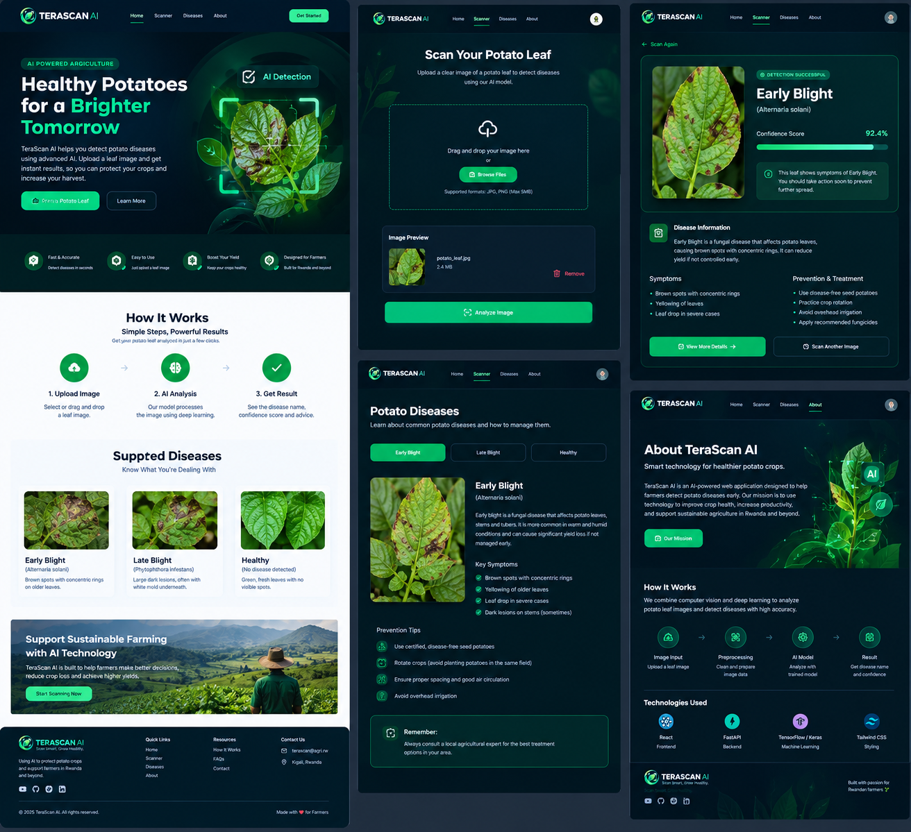

# TeraScan AI
This AI-based project which takes image of sick potato and try to predict its disease

# Sickness of Plants is one of most problem which cause financial loss to different farmers

This AI-Based project it will help you to take image of sick plant leaf with your phone and our app will generate the disease

Right now it detect only two disease of potato (Early bright and late bright) and healthy we will add another diseases in next version

We will use CNN model + quantization and fastAPI and react-native as frontend mobile App

Model is Deployed to GCP

<a href="https://www.kaggle.com/datasets/arjuntejaswi/plant-village">Dataset source image</a>

<h1>This project is build with love and coffee at desk by NIYOMUGABO Etiene & Code Explorer Rwanda Ltd</h1>
<h1>Enjoy by using our intelligent App</h1>

<h1>Figma Design Image</h1>

